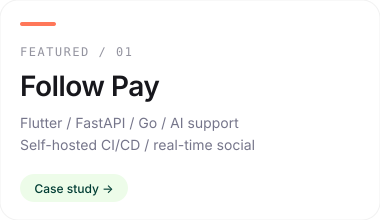
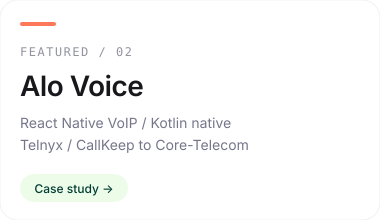
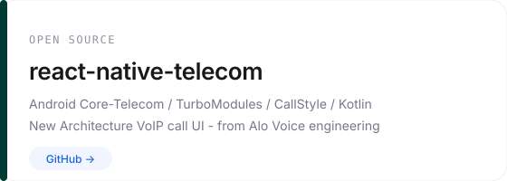
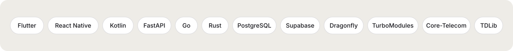

<!--
  GitHub profile README — visual cards match itxmoizdev.com
  (canvas white · deep green #003C33 · coral #FF7759 · stone #EEECE7)
-->

  

  
  
  
  

 

### ▸ Building

  
  
  

 

### ▸ Open source

  
  

  <a href="https://itxmoizdev.com/open-source/react-native-telecom">Docs · react-native-telecom</a>
  ·
  <a href="https://itxmoizdev.com/open-source/handy-tdlib-next">Docs · handy_tdlib_next</a>
  ·
  <a href="https://pub.dev/packages/handy_tdlib_next">pub.dev</a>
  ·
  <a href="https://www.npmjs.com/package/react-native-telecom">npm</a>

 

### ▸ Stack

  

 

### ▸ Contact

  

  Cross-platform when it makes sense. Native when the system demands it.
   
  <a href="https://itxmoizdev.com"><strong>itxmoizdev.com</strong></a>

